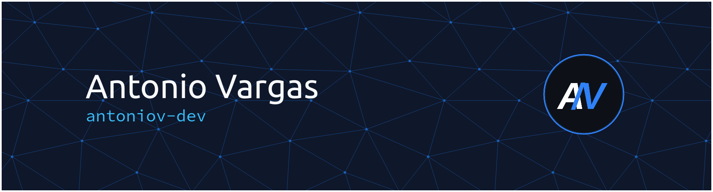

<!-- SECCIÓN 1: ENCABEZADO Y BANNER PRINCIPAL -->

  <h1 align="center">Hola, soy José Antonio 👋</h1>
  <h3>Senior Software Developer | Tech Lead | Full-Stack & Cloud Enthusiast</h3>

<!-- BADGES / INSIGNIAS DE CONTACTO Y REDES -->

  
  
  

---

## 🚀 Sobre mí

- 💻 **Rol:** Tech Lead y Senior Full-Stack Developer especializado en ecosistemas web robustos, APIs REST y sistemas financieros/de pagos.
- ⚙️ **Enfoque actual:** Diseño de arquitecturas escalables, automatización de flujos con GitHub Actions y estándares de calidad de código en equipo.
- 🔭 **Explorando:** Arquitecturas en la nube (Cloud), contenedores y despliegue continuo (CI/CD).
- 💡 **Filosofía:** Construir software limpio, desacoplado y mantenible, impulsando las mejores prácticas de ingeniería.

 

## 🛠️ Stack Tecnológico

  
  
  
  
  
  
  
  
  
  

 

## 🎯 Hitos & Certificaciones

  <table>
    <tr>
      <td align="center" width="210" valign="top">
        
         
         
        <b>Certificado de Ciberseguridad de Google</b>
      </td>
      <td align="center" width="210" valign="top">
        
         
         
        <b>Google AI Essentials V1</b>
      </td>
    </tr>
  </table>

 

### ⚙️ &nbsp;GitHub Analytics & Estadísticas

  

